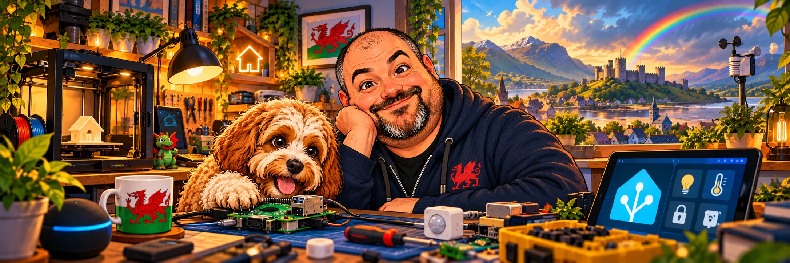
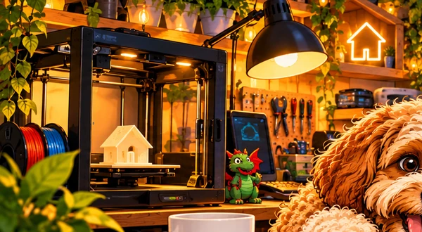
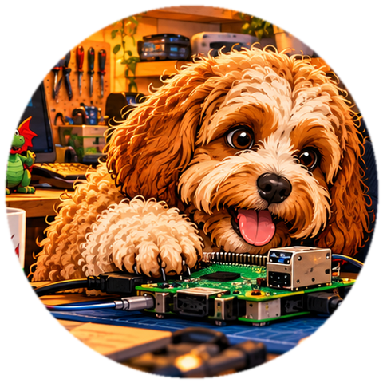

  

<h1 align="center">Shwmae! I'm Nathan. 🐉
(Bentley says hello too 🐾)</h1>

<strong>Welsh maker · Professional problem-solver · Enthusiastic breaker-and-fixer of things</strong>

<em>Adeiladwyd yng Nghymru · Built in Wales · Designed with cwtch</em>

  
  
  

---

### 👋 A bit about the person behind the keyboard

I build things for **peace, enjoyment and to fix the little frustrations in my world**.

By profession, I come from **health, safety and management systems**. For fun, I tinker with **Home Assistant, Raspberry Pi boards, web apps, automation, 3D printing and open source**. The overlap is surprisingly large: I like making complicated things **safer, calmer and easier to use**.

I'm autistic and have ADHD, and health problems mean I spend a lot of time at home. Building things is my creative escape. It helps quiet the noise, keeps my curiosity busy, and occasionally results in software somebody else might find useful.

> **My development methodology:** Find a tiny inconvenience → build a solution → discover twelve interesting side quests → remember the original inconvenience. 😄

### 🧪 Currently on the workbench

<table>
<tr>
<td width="33%" valign="top">
  
  <h3>🌦️ <a href="https://github.com/nathcymru/HA-Sky-Canvas">HA-Sky-Canvas</a></h3>
  
Bring Home Assistant dashboards to life with weather, day/night scenery and seasonal themes. <strong>Early-stage open-source project.</strong>

  
</td>
<td width="33%" valign="top">
  
  <h3>🎟️ <a href="https://github.com/Cwtch-Consulting/Tocyn">Tocyn</a></h3>
  
An open-source, Cloudflare-native helpdesk project, designed around useful workflows and thoughtful tenant isolation.

  
</td>
<td width="33%" valign="top">
  
  <h3>🧩 <a href="https://github.com/Cwtch-Consulting">Cwtch Consulting</a></h3>
  
My wider software and consultancy projects, where practical systems thinking meets ambitious ideas. Some work is kept private.

  
</td>
</tr>
</table>

### 🧰 The sort of things I tinker with

**🏠 Smart homes** — Home Assistant, dashboards, sensors, useful automations and occasionally unnecessary ones.  
**🥧 Tiny computers** — Raspberry Pi, Pico, MicroPython, electronics and making LEDs do interesting things.  
**🖥️ Software** — web applications, TypeScript, React, Rust, Python and Cloudflare's edge platform.  
**🧠 Human-friendly design** — accessible, predictable interfaces that don't make people work harder than they need to.  
**🛡️ Trust** — privacy, security, clear documentation and doing things properly without making them needlessly difficult.

### ⭐ A few GitHub rabbit holes I enjoy

These are the kinds of open-source projects that inspire my tinkering, rather than a list of projects I claim to maintain:

| Repository | Why it's here |
| :--- | :--- |
| 🏡 [home-assistant/core](https://github.com/home-assistant/core) | A whole home, coordinated without the cloud being in charge. |
| 🌡️ [esphome/esphome](https://github.com/esphome/esphome) | When an ordinary sensor could become a very satisfying weekend project. |
| 🥧 [raspberrypi/pico-examples](https://github.com/raspberrypi/pico-examples) | Small computers, big possibilities, and that first blinking LED. |
| 🎨 [chakra-ui/chakra-ui](https://github.com/chakra-ui/chakra-ui) | Thoughtful UI building blocks and accessible design. |
| ☁️ [cloudflare/workers-sdk](https://github.com/cloudflare/workers-sdk) | Building useful things close to users, without heavyweight infrastructure. |

**More discoveries:** [Browse my GitHub stars ✨](https://github.com/nathcymru?tab=stars)

---

<table>
<tr>
<td valign="middle" width="75%">
  <h3>🐾 Meet Bentley, head of quality assurance</h3>
  
Cavapoo. Expert biscuit tester. Will report critical bugs by placing a paw on the keyboard.

  
If something I've shared saves you a bit of trouble or brings you a smile, you're welcome to <a href="https://buymeacoffee.com/cicwtch">buy us a coffee</a>. Bentley would prefer the biscuit equivalent.

  
<strong>Diolch am alw heibio!</strong> — Thanks for stopping by. 🐉

</td>
<td width="25%" align="center" valign="middle">
  
</td>
</tr>
</table>

Made in Wales 🏴 · Powered by curiosity, caffeine and canine supervision. · <a href="https://github.com/Cwtch-Consulting">Cwtch Consulting</a>

