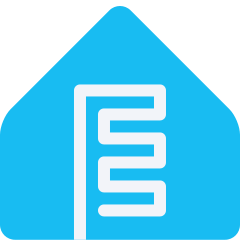
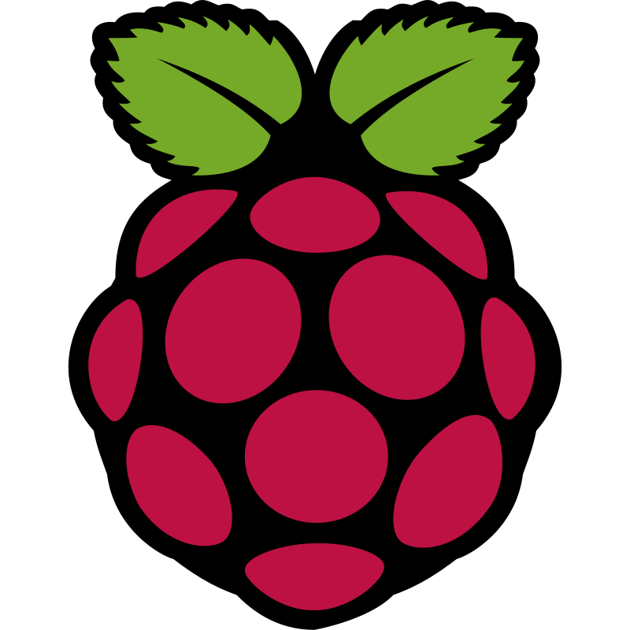
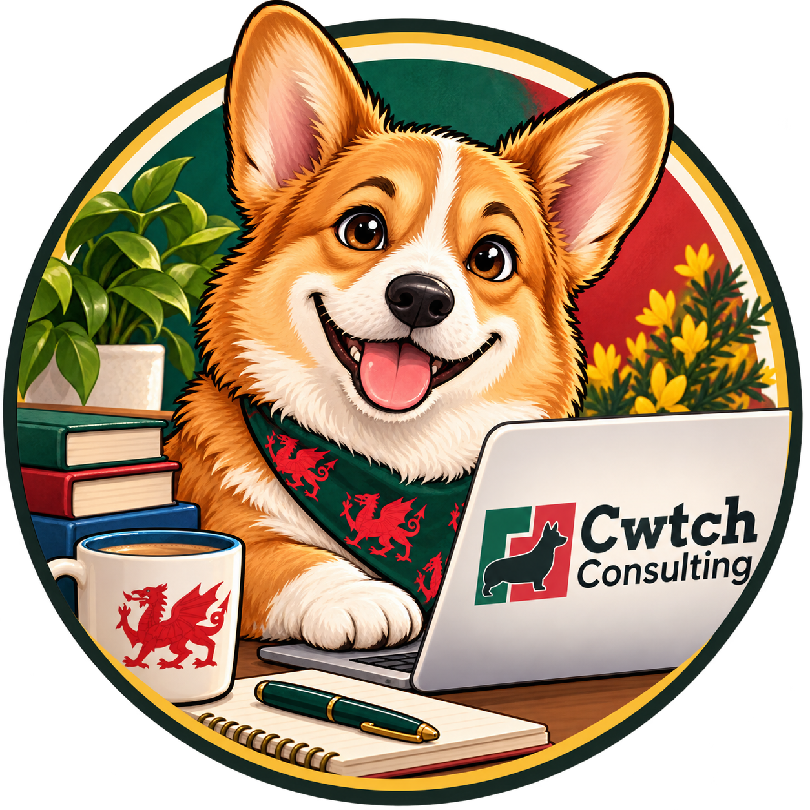
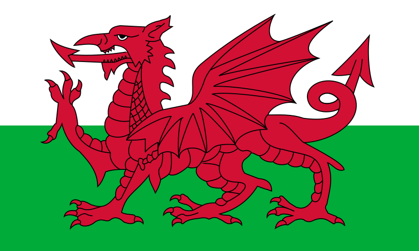

<h1>S'mae pawb! Nathan ydw i, a dyma fy mêt Bentley 🐾 
How's it going, everyone! Nathan here, and my sidekick Bentley 🐾</h1>   

  

<h2> A bit about me </h2>

<strong>Cymro · Maker · Tinkerer · Novice</strong>

I make things for **peace, enjoyment, and to fix the little frustrations in my world**. I'm autistic and have ADHD. Making things gives my curiosity somewhere to go and helps quiet the noise. This is my personal corner of GitHub: home projects, small experiments, things I find useful, and things I make just because I can. I share what I build in case it makes someone else's day a little easier.

<strong>A bit more of my story</strong>

My professional background is in health, safety and management systems. I like finding ways to make complicated things safer and easier to use. Health problems mean I spend a lot of time at home. Building things is my creative escape. There's comfort in solving a small problem, learning something new, or finally getting that sensor to behave.

My usual process:
Spot a small inconvenience
Start making a solution
Find twelve interesting side quests
Remember the original inconvenience

I like to think there's a bit of **cwtch** in that: comfort, care, and room to be yourself.

<h2> On my workbench  </h2>

<!-- Tables are now centered and stacked cleanly -->
<table align="center">
  <tr>
    <td width="350" valign="top">
      

        
      

      <h3> HA-Sky-Canvas</h3>
      
Bring your Home Assistant dashboard to life with changing weather, day and night scenery, and seasonal themes.

      
A little more life on the wall.

      

        
        
      

      

        
<strong>More about HA-Sky-Canvas</strong>

        
Animated backgrounds that respond to your weather, the time of day and your sensors. Made for Home Assistant dashboards, tablets and wall displays.

        
<a href="https://github.com/nathcymru/HA-Sky-Canvas#readme">Read the project guide</a>

      

    </td>
  </tr>
</table>

 

<table align="center">
  <tr>
    <td width="350" valign="top">
      

        
      

      <h3> Tocyn</h3>
      
A free, open-source helpdesk that helps teams keep track of support requests and organise their work.

      
From my other workbench, Cwtch Consulting.

      

        
        
      

      

        
<strong>More about Tocyn</strong>

        
Tocyn is built for Cloudflare. I maintain it as a fork of <a href="https://github.com/05ng/luminatick">Luminatick</a>, building on the original project's work.

        
The software is free and open source, under the MIT licence. It is built to stay that way.

        
<a href="https://github.com/Cwtch-Consulting/Tocyn#readme">Read the project guide</a> · <a href="https://github.com/Cwtch-Consulting/Tocyn/releases">See the releases</a>

      

    </td>
  </tr>
</table>

<h2> Things I tinker with </h2>

  
  
  
  
  
  
  
  

Smart homes, tiny computers, modelling and 3D printing. Usually with a cup of coffee going cold nearby.

<strong>Open the toolbox</strong>

###  Around the house
Home Assistant, dashboards, sensors and automations that save a little effort.

###  Tiny computers
Raspberry Pi, Pico boards, electronics and the joy of a blinking light.

###  Software
Web apps, scripts and tools that turn a repetitive job into a button press.

###  Things you can hold
3D printing, useful little parts, and finding out whether an idea fits in the real world.

<h2> My other workbench </h2>

  

<code><a href="https://github.com/Cwtch-Consulting">Cwtch Consulting</a></code> repo is home to my more formal work, including both open-source and commercial projects where I combine my skills with decades of experience in Construction Safety & Engineering. This profile <code><a href="https://github.com/nathcymru">nathcymru</a></code> is where I keep the personal tinkering. Both sides share the same curiosity and care.

<strong>A look at my other workbench</strong>

test

<h2> Meet Bentley </h2>

  

**Cavapoo. Chief Dewoofer. Expert biscuit tester.**

Bentley keeps me company and reports urgent issues by putting a paw on the keyboard. If something I've shared helps you, or makes you smile, you're welcome to buy us a coffee. Bentley would prefer a biscuit.

  
    
  Diolch am alw heibio! Thanks for stopping by.
    
  Adeiladwyd yng Nghymru · Built in Wales · Made with cwtch
    
  

